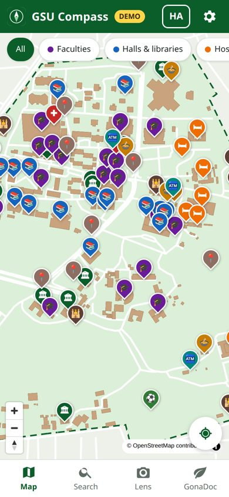
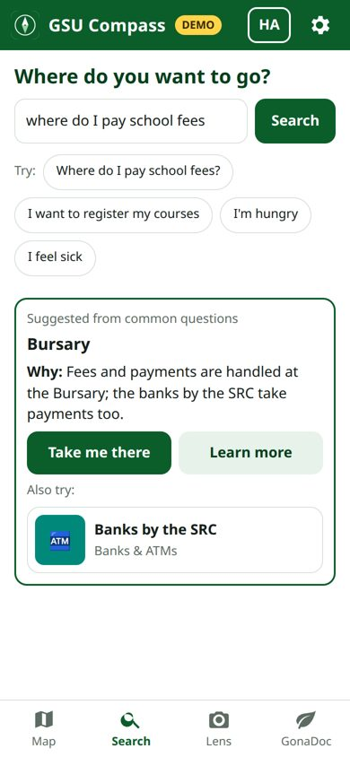
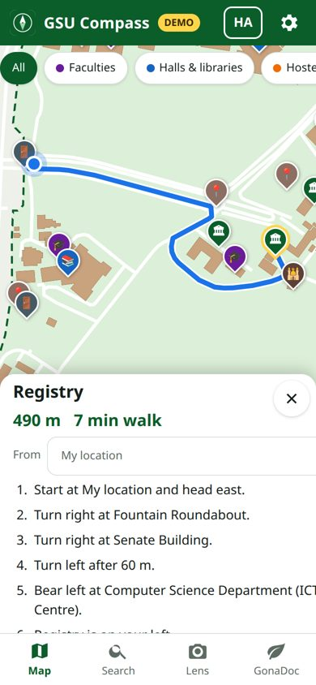
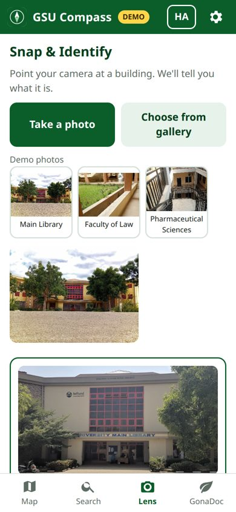
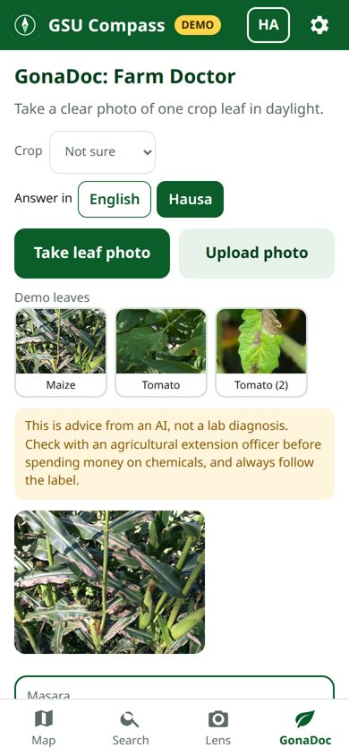

# GSU Compass

**An open-source campus guide for new students at Gombe State University (GSU), Gombe, Nigeria, with GonaDoc, a farm doctor for the crops grown around it.** Built on Gemma 4.

<p>





</p>

## The problem

Every session thousands of freshers arrive at GSU and spend their first weeks lost. The campus covers about a square kilometre, most buildings carry no visible name, and the questions that matter ("where do I pay school fees?", "where do I register my courses?", "where is LT B?") are answered by asking strangers. Official maps are out of date or missing, and many students are more at home in Hausa than in English.

Around the campus, smallholder farmers lose maize, tomato, groundnut, sorghum, rice and bean harvests to diseases they cannot name, far from an extension officer.

## What it does

| Tab | What it does |
|---|---|
| **Map** | Vector map of the campus with about 90 places in 11 colour-coded categories, a category filter, your live GPS position, and a details sheet for every place (photos, description, opening hours, "Take me there"). |
| **Search** | "Where do you want to go?" Fuzzy matching on names and aliases (typos, Hausa and slang names: *laburare*, *masallaci*, *babban kofa*). Questions it cannot match go to **Gemma 4**, which picks the right office and says why: "where do I pay school fees" gives the Bursary. |
| **Directions** | Walking route from your GPS or any chosen start, computed in the browser with Dijkstra over the real campus footpaths. Distance, walking time and plain turn-by-turn steps with landmarks ("Turn right at Fountain Roundabout", "Registry is on your left"). Gemma can rewrite them into friendlier English or Hausa. |
| **Lens** | Snap a building. The server keeps only places within about 250 m of your GPS and sends Gemma 4 your photo with each candidate's reference photo and description. You get the place, a confidence and a one-line reason, or the top 3 guesses when it is not sure. |
| **GonaDoc** | Photograph a crop leaf. Gemma 4 vision returns the crop, likely disease or pest, confidence, symptoms seen, treatment (cheap and locally available first), prevention and when to see an extension officer, in English or Hausa, always with a "this is advice, not a lab diagnosis" warning. |
| **Admin** | Behind a PIN: stand at a building, tap "Use my location" (or tap the map), enter its names and category, take 1 to 3 reference photos, and save. This is how real campus data is collected. |

The whole interface switches between **English and Hausa**, and AI answers come back in the chosen language.

## Built to survive a live demo

- Every Gemma call asks for JSON matching a strict schema, has a timeout, and turns any failure into a friendly message. If a model refuses structured-output mode, the schema moves into the prompt and the reply is validated on the server.
- Search keeps working with no AI at all: keyword rules (`data/intents.json`) answer the common questions, in the browser if the server is unreachable.
- When Lens cannot reach the AI it still shows the places nearest to you.
- Photos are shrunk on the phone to 1024 px before upload.
- **`/demo`** runs with a fixed position at the Main Gate, sample building photos and sample leaves. If the network or the AI is down, it falls back to recorded answers for those samples. If OpenFreeMap tiles cannot load, the map switches to an offline campus basemap (boundary, 275 building footprints, footpaths) shipped with the app.
- PWA: installable, and the app shell, places and map data are cached for offline use.

## Run it

Needs Python 3.11 or newer.

```bash
git clone <this repo> GSU-Compass && cd GSU-Compass
pip install -r requirements.txt
cp .env.example .env        # add GEMINI_API_KEY (https://aistudio.google.com/apikey) and an ADMIN_PIN
uvicorn app.main:app --host 0.0.0.0 --port 8000
```

Open http://localhost:8000, or http://localhost:8000/demo for the pitch version.

At startup the server lists the models your key can use and picks the best Gemma 4 one: 26B, then 31B, then E4B (the 26B mixture-of-experts model is the fastest of the large ones). The choice is logged and shown at `/healthz`. Set `GEMMA_MODEL` in `.env` to force one.

### On your phone

Phones only give GPS and the camera to secure (https) pages, so on the local network use:

```bash
./run_https.sh            # prints https://<laptop-ip>:8443
```

Put the phone on the same Wi-Fi, open the printed address, tap **Advanced** then **Proceed** (the certificate is self-signed), and allow location. Plain http://<laptop-ip>:8000 works too, but without live GPS: routes then start from a place you choose. To install it as an app, deploy it (below) and use "Add to Home screen".

### Tests

```bash
# phone-sized browser run through every tab, in demo mode, with ADMIN_PIN=2468
PLAYWRIGHT=/path/to/node_modules/playwright-core node tests/smoke.cjs http://localhost:8000
```

## Deploy to DigitalOcean App Platform

1. Push this repo to GitHub.
2. In `.do/app.yaml` set `repo:` to your GitHub repo, then run `doctl apps create --spec .do/app.yaml`, or create an app in the dashboard from the repo (it detects the `Dockerfile`).
3. Add `GEMINI_API_KEY` and `ADMIN_PIN` as encrypted environment variables.
4. The health check is `/healthz`. App Platform gives you https, so GPS, camera and install work at once.

The `Procfile` also works on buildpack platforms. Note: App Platform's disk is reset on every deploy, so places and photos added in admin mode live only until the next deploy. Collect data on a laptop (or download `data/places.json` and `static/photos/user/` before redeploying) and commit it.

## Architecture

```
phone browser (plain HTML/CSS/JS, no build step)              FastAPI (one process)
┌──────────────────────────────────────────┐   JSON     ┌─────────────────────────────────┐
│ MapLibre GL + OpenFreeMap tiles          │◀──────────▶│ /api/places, /api/geo/*         │ data/*.json, *.geojson
│   or offline campus basemap              │            │ /api/resolve      ─┐            │
│ fuzzy search + keyword rules             │            │ /api/directions/   │  Gemma 4   │
│ Dijkstra over footpaths, step text       │  photos    │   rewrite          ├─▶ Google AI │
│ image compression (1024 px)              │──────────▶ │ /api/identify      │  Studio    │
│ i18n.json (English / Hausa)              │            │ /api/gonadoc      ─┘ (google-   │
│ service worker (offline, install)        │            │ /api/admin/*  (PIN)    genai)   │
└──────────────────────────────────────────┘            │ static files, /demo             │
                                                        └─────────────────────────────────┘
```

| Path | What |
|---|---|
| `app/main.py` | Routes, upload handling, admin PIN, error handler |
| `app/gemma.py` | Model selection, JSON schema calls, timeouts, fallbacks |
| `app/features.py` | Prompts and logic for search, step rewriting, Lens and GonaDoc; demo answers |
| `static/js/` | `map.js` map and markers, `route.js` graph and directions, `search.js`, `lens.js`, `gonadoc.js`, `admin.js`, `app.js` start-up |
| `data/places.json` | The places (id, name, aliases, category, lat, lng, description, opening_hours, reference_photos, approximate) |
| `data/paths.geojson` | Walkable lines for routing |
| `tools/build_data.py` | Rebuilds the data files |

### Where the data comes from

- **Places**: the named points OpenStreetMap holds inside the mapped university boundary, corrected by people who know the campus (for example, the place OSM calls "Works department" is the Computer Science Department in the ICT Centre, and the University Clinic is beside the Faculty of Law). Every seed position is marked `"approximate": true` until someone checks it on the ground with admin mode, which writes `"approximate": false`.
- **Paths**: every OSM road and footway within 350 m of the campus. The campus has only two open gates (the Main Gate and Gate 3), so lines crossing the wall anywhere else are cut there.
- **Photos**: 121 openly licensed photographs of GSU from Wikimedia Commons, credited in [CREDITS.md](CREDITS.md). `tools/fetch_photos.py` downloads them again.

## Known limits

- Seed positions are approximate. The New Multipurpose Hall and the Faculty of Science Complex footprint are estimates, and which buildings are Female Hostel Halls 2 and 3 is a guess. Fix them with admin mode.
- The Hausa strings were written without a native-speaker review yet.
- Lens is only as good as the reference photos: places without a photo are matched on description alone.
- GonaDoc is guidance, not diagnosis.

## Licence

Code: [MIT](LICENSE). Photographs: their own Creative Commons licences, see [CREDITS.md](CREDITS.md). Map data © OpenStreetMap contributors (ODbL), tiles by OpenFreeMap.
